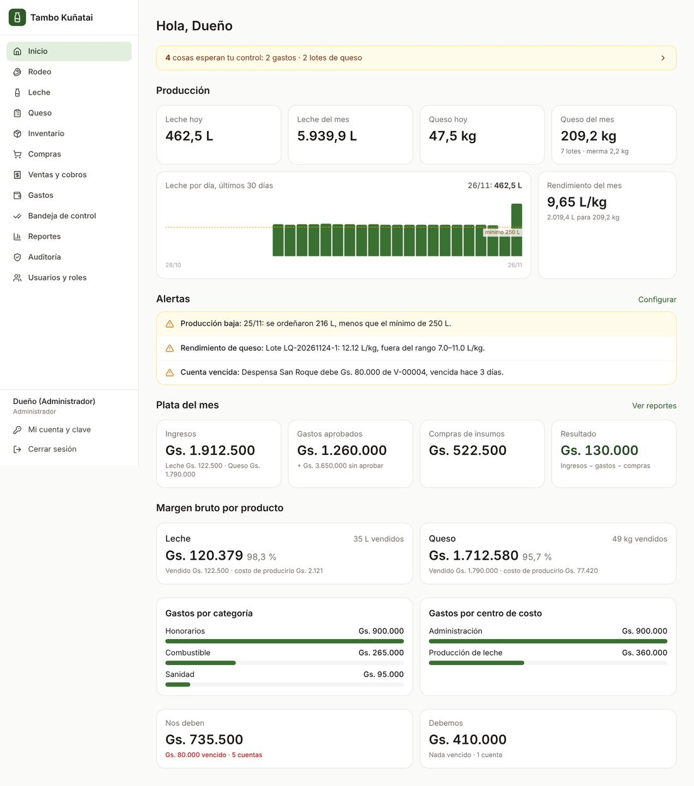
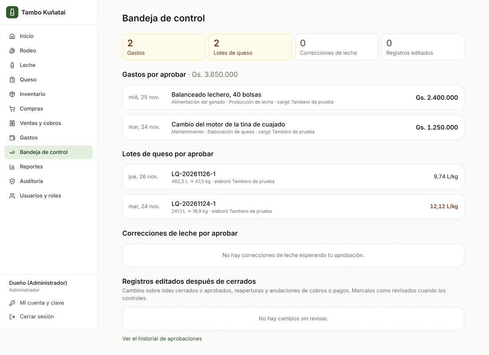
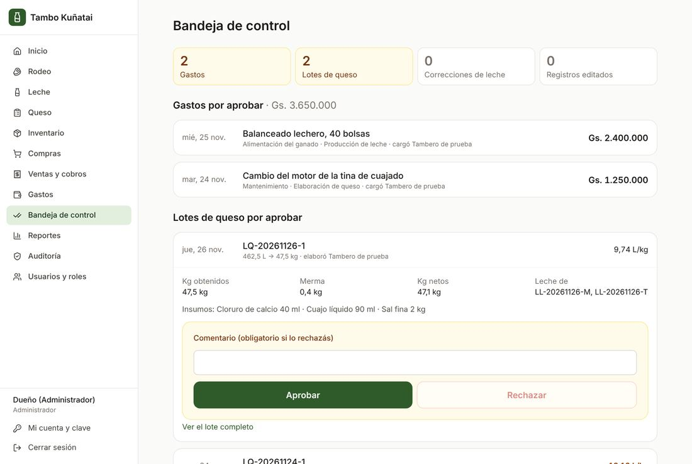
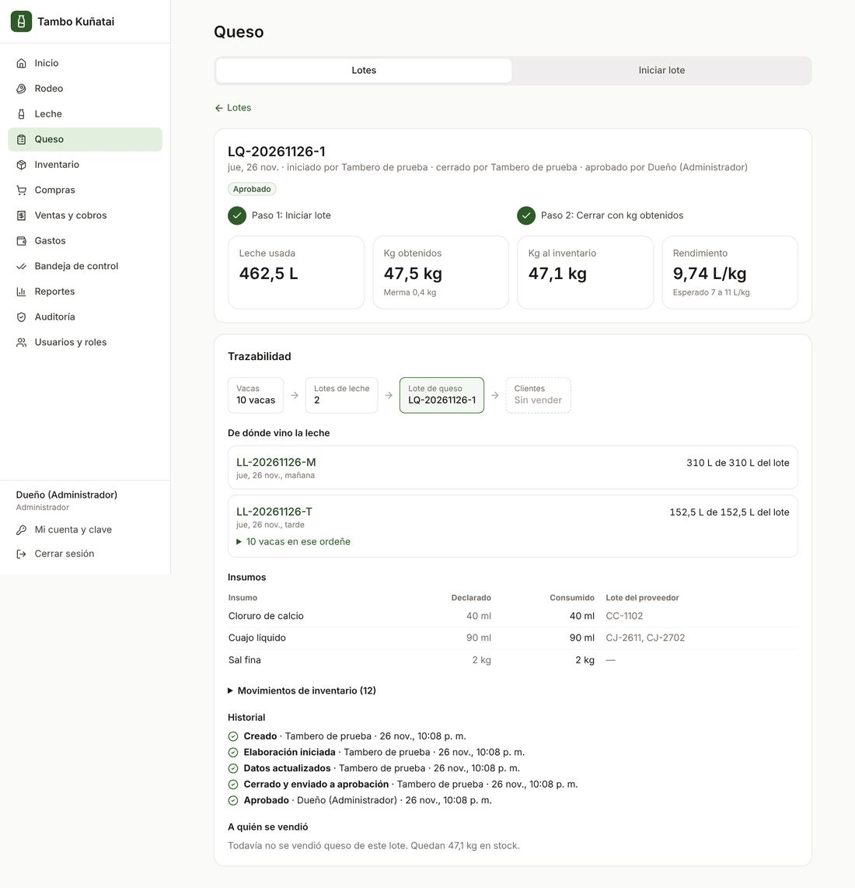
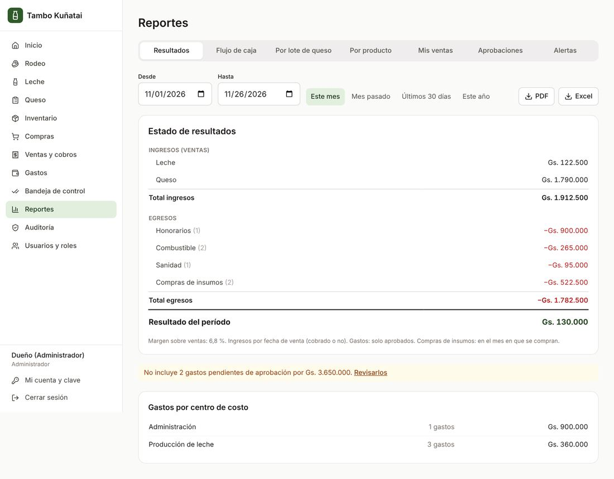
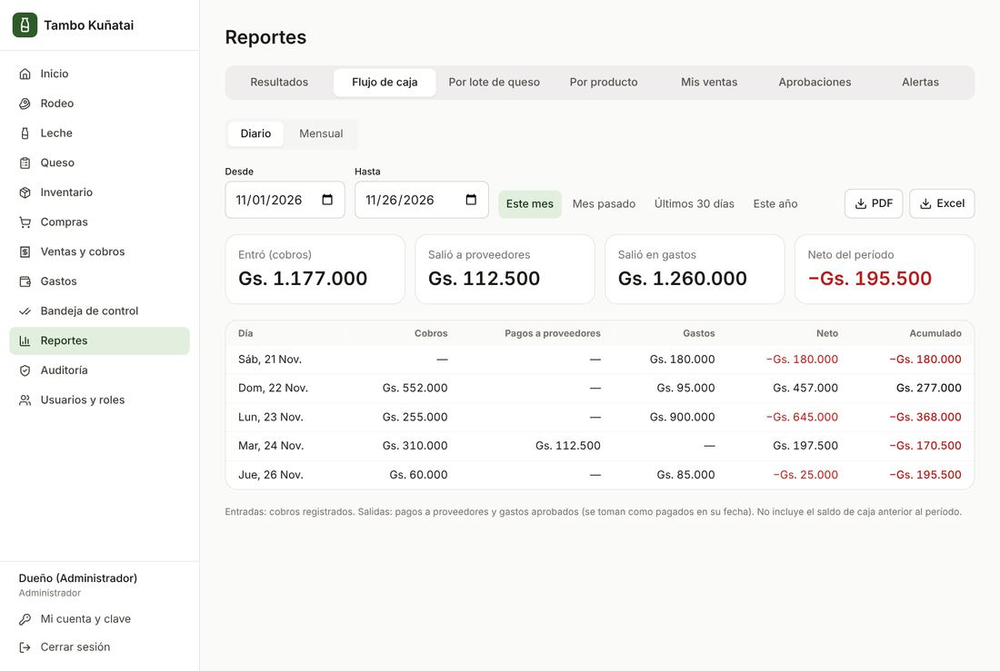
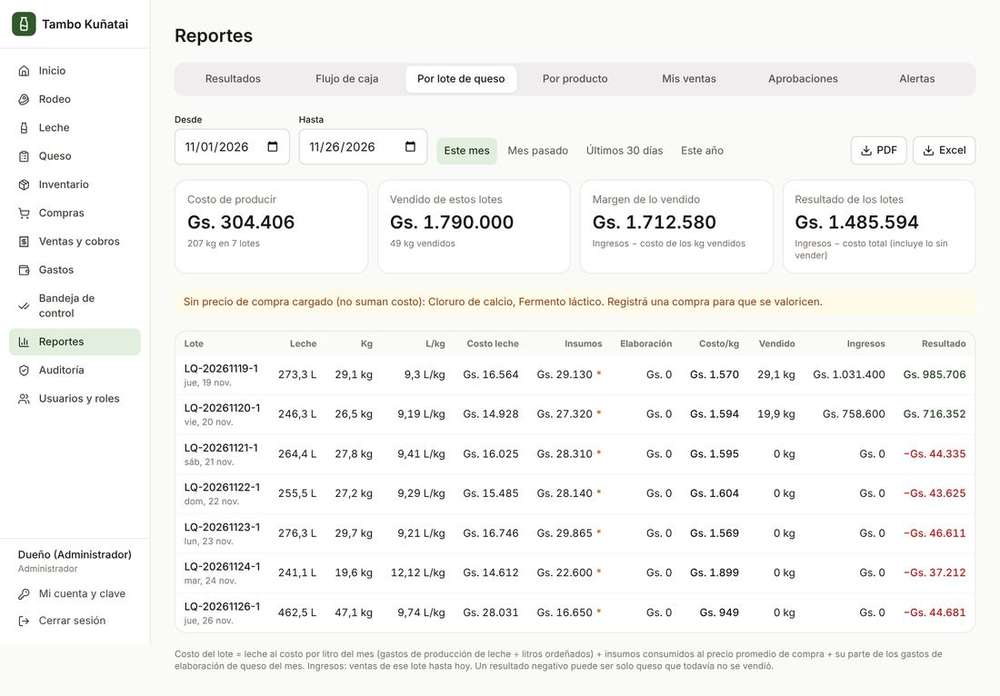
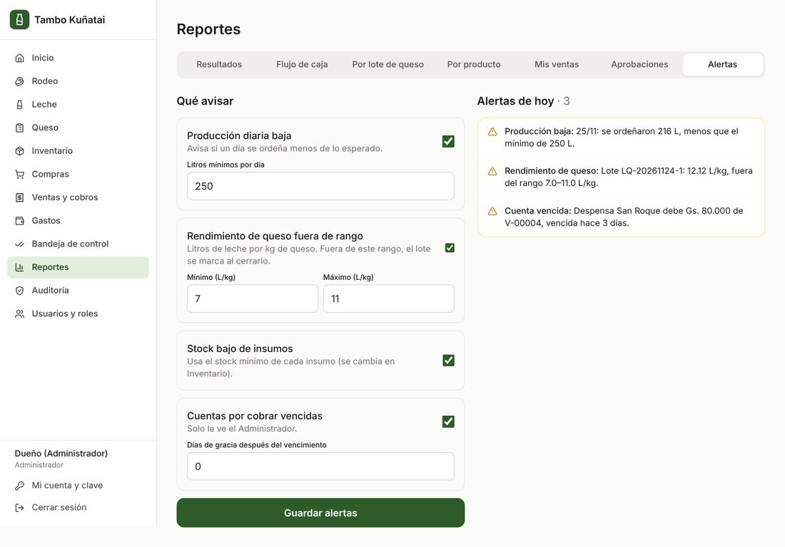
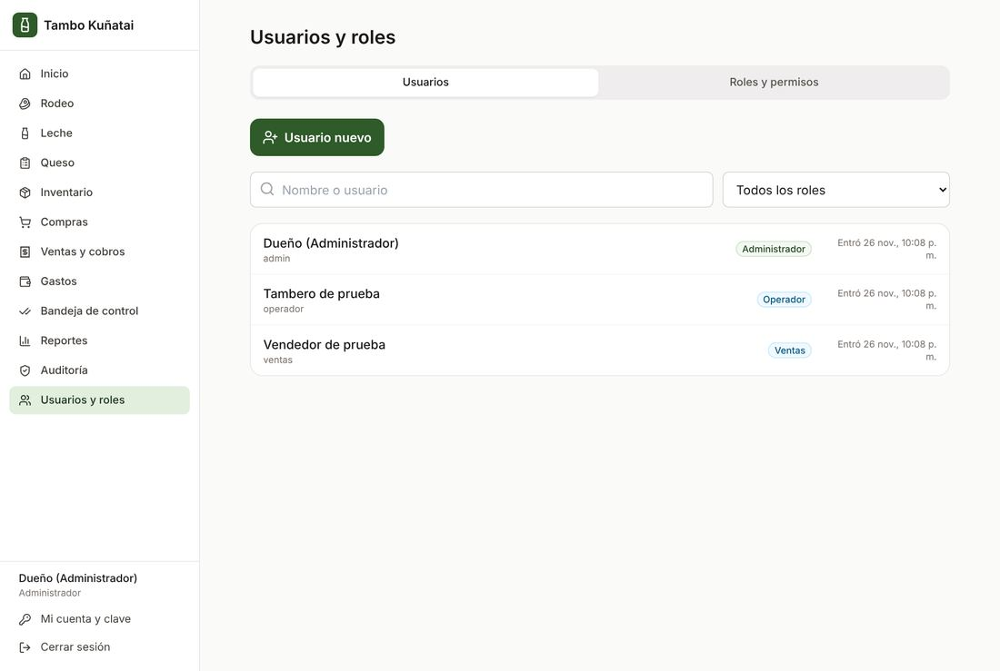
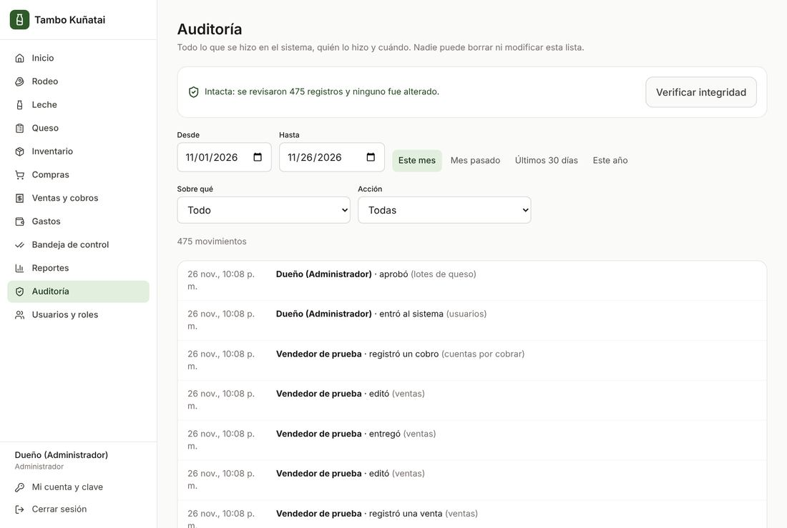

# Manual del Administrador

Para el dueño: cómo controlar y aprobar lo que carga el equipo, seguir un queso desde la vaca hasta el
cliente, leer los reportes y bajarlos en PDF o Excel. Lo que cargan los operadores está en el
[Manual del Operador](MANUAL_OPERADOR.md); el Administrador también puede hacer todo eso.

---

## 1. El tablero (Inicio)

Al entrar ves el día y el mes de un vistazo:

- **Arriba, en amarillo**: cuántas cosas esperan tu control (gastos, lotes de queso, correcciones de leche,
  registros editados). Tocalo para ir a la bandeja.
- **Producción**: leche y queso de hoy y del mes, rendimiento del mes y la leche de los últimos 30 días
  (pasá el dedo o el mouse por una barra para ver el día). La línea punteada es el mínimo de la alerta.
- **Alertas**: días con poca leche, quesos con rendimiento fuera de rango, insumos bajo el mínimo y
  clientes con deudas vencidas. Cada alerta lleva a lo que hay que mirar.
- **Plata del mes**: ingresos (leche y queso), gastos aprobados, compras de insumos y el **resultado**.
- **Margen bruto por producto**: lo vendido menos lo que costó producir eso que se vendió.
- **Gastos por categoría y por centro de costo**.
- **Nos deben / Debemos**: cuentas por cobrar y por pagar, con lo vencido en rojo.

Los operadores ven solo la parte de producción y alertas: nada de plata.

---

## 2. Aprobar y controlar: la Bandeja de control

Menú → **Bandeja de control**. Todo lo que espera tu decisión, en una pantalla. Los cuadros de arriba
cuentan cuántos hay de cada cosa; tocá uno para ir a esa parte.

### Gastos por aprobar

Aparecen los gastos que superan el monto de aprobación automática (Gs. 500.000 si no se cambió). Tocá uno:
ves la foto del comprobante, quién lo cargó, la categoría y el centro de costo.

- **Aprobar**: el comentario es opcional.
- **Rechazar**: el comentario es obligatorio. Escribí qué hay que corregir; quien lo cargó lo ve, lo
  arregla y te vuelve a llegar.

Los gastos que cargás vos se aprueban solos.

### Lotes de queso por aprobar

Cada lote muestra la leche usada, los kg y el **rendimiento** (en naranja si está fuera del rango
esperado). Tocá uno, revisá y **Aprobar** (el queso queda disponible para vender) o **Rechazar** con un
comentario (el elaborador lo corrige y lo vuelve a enviar).

### Correcciones de leche

Cuando un operador corrige un lote de leche **ya cerrado**, el cambio no se aplica hasta que lo apruebes.
Ves el valor anterior y el propuesto, con el motivo.

### Registros editados después de cerrados

Lista los cambios hechos sobre registros que ya estaban cerrados o aprobados: ediciones del
Administrador, correcciones aplicadas, reaperturas y anulaciones de cobros, pagos o registros aprobados.
Sirve para que nada cambie sin que lo veas. Tocá uno, mirá qué cambió y quién fue, escribí una nota si
querés y tocá **Marcar revisado**: sale de la bandeja y la revisión queda registrada.

Abajo de todo está el enlace al **historial de aprobaciones** (quién aprobó o rechazó qué y cuándo).

---

## 3. Trazabilidad: de la vaca al cliente

Abrí un lote de queso (Menú → **Queso** → tocá el lote). La sección **Trazabilidad** muestra la cadena
completa:

- **Vacas → lotes de leche → lote de queso → clientes**.
- **De dónde vino la leche**: cada lote de leche con los litros usados. Si se cargó el ordeñe por vaca,
  tocá *"N vacas en ese ordeñe"* para ver cuáles.
- **Insumos**: lo declarado al iniciar, lo consumido de verdad y el lote del proveedor de cada insumo.
- **Movimientos de inventario** del lote.
- **Historial**: quién lo creó, lo cerró y lo aprobó, con fecha y hora.
- **A quién se vendió**: cada venta con cliente y kg, y cuánto queda en stock.

También se recorre al revés:

- Desde un **lote de leche** se ve en qué quesos terminó.
- Desde un **cliente** (Ventas y cobros → Clientes) se ven todas sus compras y de qué lotes salieron.

Si un cliente reclama por un queso, con el número de lote sabés de qué leche, de qué vacas y con qué
insumos se hizo, y a qué otros clientes se vendió ese mismo lote.

---

## 4. Reportes

Menú → **Reportes**. Todos tienen arriba el **período**: fechas *Desde* y *Hasta*, o los atajos
*Este mes*, *Mes pasado*, *Últimos 30 días* y *Este año*. Y los botones **PDF** y **Excel** para bajar
exactamente lo que se ve en pantalla.

### Resultados (estado de resultados)

**Resultado = ventas − gastos aprobados − compras de insumos**, del período elegido.

- **Ventas**: las no anuladas, por la fecha de la venta (aunque no se hayan cobrado).
- **Gastos**: solo los aprobados, por categoría. Los pendientes se muestran aparte y no restan.
- **Compras de insumos**: cuentan en el mes en que se compran (decisión tuya del 26/11/2026).

Cada renglón es un enlace a las ventas, gastos o compras que lo forman, para revisar de dónde sale cada número.

### Flujo de caja

La plata que **entró** (cobros) y **salió** (pagos a proveedores y gastos), día por día o mes por mes, con el
saldo acumulado. Una venta a crédito aparece cuando se cobra, no cuando se vende.

### Por lote de queso

Cuánto costó producir cada lote y cuánto se vendió de él.

**Costo del lote = leche + insumos + elaboración.**

| Parte | Cómo se calcula |
| ----- | --------------- |
| Leche | Litros usados × costo del litro. El costo del litro sale de los gastos aprobados de *Producción de leche* del mes ÷ litros ordeñados ese mes |
| Insumos | Lo consumido, al precio promedio de compra |
| Elaboración | La parte del lote en los gastos de *Elaboración de queso* del mes, repartida por litros |

Si un insumo nunca se compró por el sistema, no suma costo y el reporte lo avisa. Un resultado negativo
puede ser solo queso que todavía no se vendió.

### Por producto

Leche y queso: lo vendido, el costo de producir **lo que se vendió** (no lo que está en stock) y el margen
bruto. Incluye el costo del litro mes por mes. Los gastos de Administración se muestran aparte y no se
reparten.

### Aprobaciones

Quién aprobó o rechazó cada gasto, lote de queso y corrección de leche, cuándo y con qué comentario.
Los gastos que se aprobaron solos figuran como *Aprobó automáticamente*.

### Alertas

Qué avisar y con qué límites:

- **Producción diaria baja**: litros mínimos por día.
- **Rendimiento de queso fuera de rango**: mínimo y máximo en L/kg.
- **Insumos bajo el stock mínimo**: el mínimo se fija en cada insumo.
- **Cuentas por cobrar vencidas**: con días de gracia.

Activá o desactivá cada una, cambiá los valores y tocá **Guardar alertas**. Abajo ves las alertas de hoy
con esos valores. Los operadores pueden ver esta pantalla pero no cambiarla.

### Mis ventas

Lo que vendió y cobró el usuario que entra (pensado para el rol Ventas). Como Administrador ves solo las
ventas que cargaste vos; las de todos están en Resultados y en Ventas y cobros.

---

## 5. Correcciones y anulaciones

En el sistema **nada se borra**: un error se corrige o se anula con un motivo, y todo queda en la auditoría.

| Qué | Cómo | Qué pasa |
| --- | ---- | -------- |
| Lote de leche cerrado | Abrí el lote → **Corregir datos del lote** (motivo obligatorio), **Reabrir** o **Anular lote** | Se aplica enseguida y aparece en *Registros editados* |
| Venta | Abrí la venta → **Anular venta** (motivo) | El stock vuelve y la cuenta por cobrar se anula |
| Cobro mal cargado | Ventas y cobros → **Cuentas por cobrar** → **Anular cobro** | La deuda vuelve a quedar abierta |
| Compra | Abrí la compra → **Anular compra** (sin pagos vigentes) | El stock vuelve a bajar |
| Pago a proveedor | Compras → **Cuentas por pagar** → **Anular pago** | La deuda con el proveedor vuelve a quedar abierta |
| Gasto | Abrí el gasto → **Anular gasto** (motivo) | Deja de contar en los reportes |

Las acciones que no se deshacen con un toque piden confirmación: anular pide el motivo, y cerrar un lote,
quitar un destino o un precio, o desactivar un usuario preguntan *"¿Seguro?"* antes.

---

## 6. Usuarios y roles

Menú → **Usuarios y roles**.

| Rol | Para quién | Qué puede |
| --- | ---------- | --------- |
| **Administrador** | El dueño | Todo: aprobar, reportes con plata, auditoría, usuarios, anular y reabrir |
| **Operador** | Tamberos y encargados de elaboración | Rodeo, leche, queso, inventario, compras y sus propios gastos; ve producción y alertas, sin plata |
| **Ventas** | Quien vende y cobra | Clientes, ventas, cobros, sus propios gastos y *Mis ventas* |

- **Usuario nuevo**: nombre, usuario, teléfono, rol y una clave provisoria. La primera vez que entra, el
  sistema le pide que elija su clave.
- **Editar o restablecer clave**: si alguien se olvidó la clave o quedó bloqueado. La nueva es provisoria.
- **Desactivar**: la persona ya no puede entrar. Pregunta antes de hacerlo. No se borra, para que su
  historial siga en la auditoría. Se puede **Reactivar**.
- **Roles y permisos** muestra qué puede hacer cada rol.

---

## 7. Auditoría

Menú → **Auditoría**. Todo lo que se hizo en el sistema: quién, qué, cuándo, desde qué IP y teléfono, y
qué cambió. Se filtra por fechas, por tema (lotes de leche, gastos, ventas…) y por acción (aprobó, anuló,
editó un registro cerrado…). Tocá un movimiento para ver el detalle de los cambios.

**Verificar integridad** comprueba que nadie haya tocado la auditoría directamente en la base de datos,
por fuera del sistema. Tiene que decir *Intacta*.

---

## 8. Lo que conviene revisar cada semana

1. La **Bandeja de control** en cero, incluidos los *Registros editados*.
2. Las **alertas** del tablero, sobre todo los rendimientos fuera de rango y las cuentas vencidas.
3. **Reportes → Resultados** del mes en curso contra el mes pasado.
4. **Auditoría → Verificar integridad**.
5. Que el respaldo automático esté corriendo: quien administra el servidor puede confirmarlo en
   `respaldos/respaldo.log` (ver [DESPLIEGUE.md](DESPLIEGUE.md#respaldos)).

## 9. Datos que solo carga el Administrador

- **Precios** (Ventas y cobros → Precios): precio por producto, tipo de cliente y cantidad mínima. Sin
  precio cargado no se puede vender ese producto.
- **Insumos y stock mínimo** (Inventario): el mínimo dispara la alerta de stock bajo. Los ajustes de stock
  que proponen los operadores los aprobás vos.
- **Cuentas por cobrar y por pagar**: solo las ve el Administrador.
