# Manual del Operador

Para tamberos, encargados de elaboración y vendedores. Explica, paso a paso, cómo cargar un día completo
en el sistema desde el celular: la leche, el queso, los gastos y las ventas.

No hace falta saber de computación. Si algo no sale, mirá [Problemas comunes](#problemas-comunes) al final.

---

## Antes de empezar

### Entrar al sistema

1. Abrí el navegador del celular (Chrome) y entrá a la dirección que te pasó el dueño.
2. Escribí tu **Usuario** y tu **Clave** y tocá **Ingresar**.
3. La primera vez, el sistema te pide que cambies la clave provisoria por una tuya. Tiene que tener
   al menos 8 caracteres, no puede ser solo números ni parecerse a tu usuario.

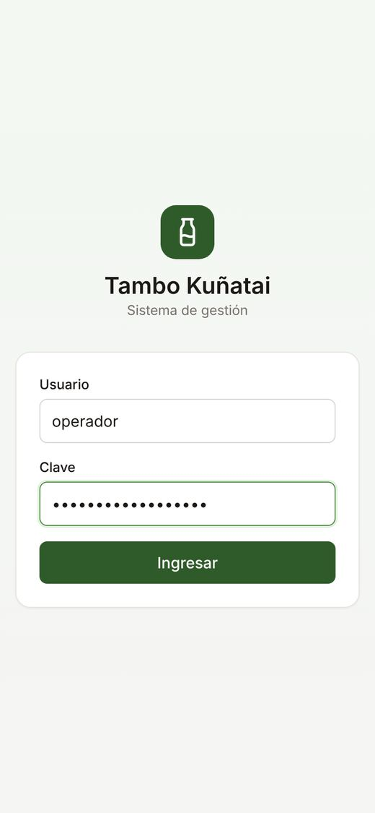

**Truco:** en Chrome tocá los tres puntitos ⋮ → **Agregar a la pantalla principal**. Te queda un ícono
como si fuera una aplicación.

Si ponés mal la clave 5 veces seguidas, tu usuario queda bloqueado **15 minutos**. Esperá, o pedile al
dueño que te la restablezca.

### La pantalla de inicio

Al entrar ves la producción de hoy y del mes, el gráfico de leche de los últimos 30 días y las
**alertas** (por ejemplo, un día con poca leche o un queso que rindió raro). El menú está en las tres
rayitas ☰ de arriba a la izquierda.

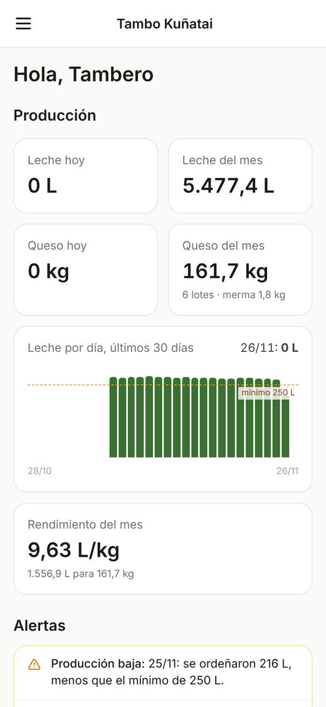

### Sin señal

Si en el corral no hay señal, **la leche y el ordeñe por vaca igual se guardan en el teléfono**. Vas a ver
un aviso amarillo: *"1 lote guardado en este teléfono. Se envían solos cuando vuelva la señal."* No cierres
la sesión hasta que vuelva la señal y desaparezca el aviso.

Para el resto (queso, gastos, ventas) hace falta señal. Si no hay, el sistema avisa:
*"No hay conexión con el sistema. Revisá la señal o el wifi y probá de nuevo."* No se pierde lo que
escribiste: esperá a tener señal y tocá de nuevo el botón.

---

## El día en el tambo, en resumen

| Cuándo | Qué cargar | Dónde |
| ------ | ---------- | ----- |
| Después del ordeñe de la mañana | Los litros (total o vaca por vaca) | **Leche → Registrar** o **Rodeo → Ordeñe por vaca** |
| Después del ordeñe de la tarde | Lo mismo | Ídem |
| Al empezar a elaborar queso | La leche y los insumos que vas a usar | **Queso → Iniciar lote** |
| Al terminar el queso | Los kg obtenidos y los insumos que se usaron de verdad | El lote de queso → **Paso 2** |
| Cada vez que se gasta plata | El gasto con la foto del comprobante | **Gastos → Cargar gasto** |
| Cada venta (rol Ventas) | La venta y, si pagó, el cobro | **Ventas y cobros → Registrar venta** |

---

## 1. Cargar la leche del ordeñe

Hay dos formas. Usá **una sola por ordeñe**: o el total del tambo, o vaca por vaca.

### Forma A: el total del ordeñe

1. Menú → **Leche** → pestaña **Registrar**.
2. **Fecha**: ya viene la de hoy.
3. **Ordeñe**: tocá **Mañana** o **Tarde** (el sistema propone uno según la hora).
4. **Litros**: escribí el total del ordeñe, por ejemplo `310`. Si tiene decimales, usá coma: `310,5`.
5. **Destino**: tocá adónde va la leche.
   - **Queso**: se va a elaborar.
   - **Venta**: se vende cruda.
   - **Descarte**: por ejemplo, leche con antibiótico.
   - **Pendiente**: todavía no se sabe.
6. Si medís grasa, proteína o temperatura, tocá **Calidad y observaciones (opcional)**.
7. Tocá **Guardar**. Aparece *"Listo: LL-20261126-M con 310 L. Ver lote"*.

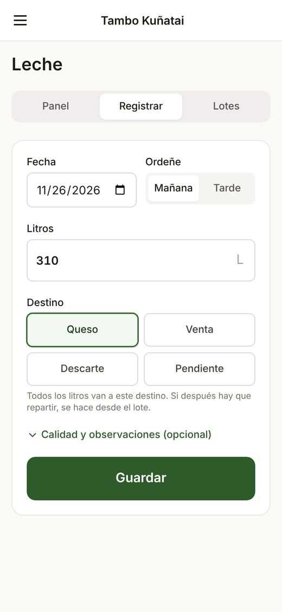 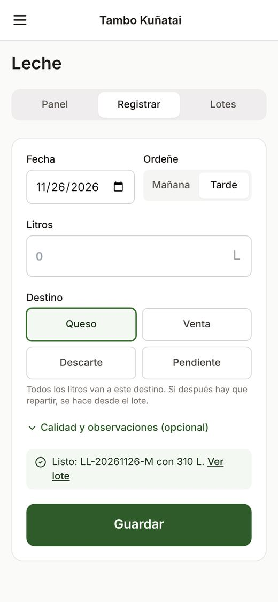

El código del lote dice la fecha y el ordeñe: `LL-20261126-M` es la leche del 26/11 a la mañana
(`-T` es la tarde).

### Forma B: vaca por vaca

1. Menú → **Rodeo** → pestaña **Ordeñe por vaca**.
2. Elegí **Mañana** o **Tarde**.
3. Al lado de cada vaca (número de caravana y nombre), escribí los litros que dio. Las que no se
   ordeñaron, dejalas vacías.
4. Abajo se va sumando el **Total**. Elegí el **Destino del lote** y tocá **Guardar planilla**.

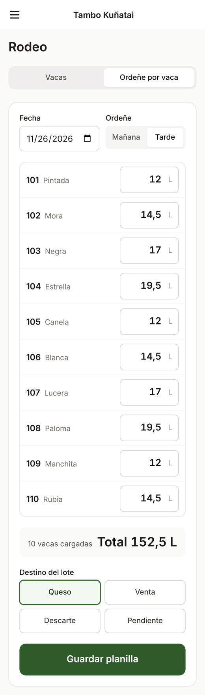

Así el dueño puede ver qué vacas vienen bajando o subiendo. El sistema arma solo el lote del ordeñe con
la suma.

### Me equivoqué en los litros

Entrá al lote (Leche → **Lotes** → tocá el lote) y tocá **Corregir datos del lote**. Mientras el lote está
abierto, el cambio se guarda enseguida. Si el lote ya está cerrado, la corrección le llega al dueño para
que la apruebe y el lote no cambia hasta entonces.

### Repartir y cerrar el lote de leche

Un lote se cierra cuando todos sus litros tienen destino. Si al registrarlo elegiste Queso, Venta o
Descarte, ya lo tienen todos. Si elegiste **Pendiente**, o si querés repartir (por ejemplo, una parte a
queso y otra a venta):

1. Leche → **Lotes** → tocá el lote.
2. En **Destinos**, elegí el destino, escribí los litros (vacío = todo lo que queda) y tocá **Asignar**.
   Un destino mal puesto se quita con el tachito (pregunta *"¿Quitar?"* antes).
3. Cuando ya no quedan litros sin destino aparece **Cerrar lote**. Al tocarlo pregunta
   *"¿Cerrar? Después solo el Administrador lo puede cambiar."*. Tocá **Sí, cerrar**.

---

## 2. Elaborar queso

El queso se carga en **dos pasos**: al empezar (qué leche e insumos se usan) y al terminar (cuántos kg
salieron).

### Paso 1: iniciar el lote

1. Menú → **Queso** → **Iniciar lote**.
2. En **Leche de origen**, marcá los lotes de leche que van a la tina. Al marcar uno se completa con todos
   sus litros disponibles; si usás menos, cambiá el número.
3. En **Insumos que vas a usar**, escribí la cantidad de cada uno (cuajo en ml, sal en kg, etc.). Los que
   no usás, dejalos en 0.
4. Tocá **Iniciar lote con … L**.

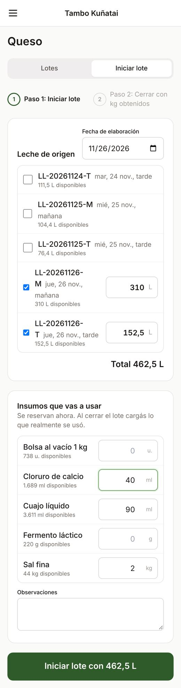

La leche se descuenta y los insumos quedan reservados para ese lote. El lote queda **En elaboración**.

### Paso 2: cerrar el lote cuando el queso está listo

1. Menú → **Queso** → tocá el lote *En elaboración*.
2. **Kg de queso obtenidos**: lo que pesó, por ejemplo `47,5`.
3. **Merma (kg)**: lo que se perdió o no sirve, si hubo.
4. El sistema muestra el **Rendimiento** (litros por kg). Si sale muy alto o muy bajo, revisá el peso
   antes de seguir.
5. **Insumos usados de verdad**: vienen con lo que declaraste; cambialos si usaste distinto.
6. Tocá **Cerrar lote y enviar a aprobación**.

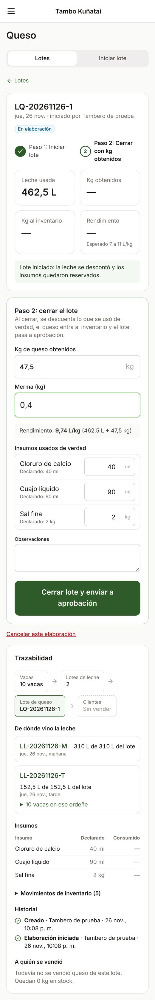 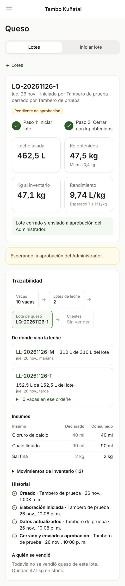

El lote queda *"Esperando la aprobación del Administrador"*. Cuando el dueño lo aprueba, el queso
queda disponible para vender. Si lo **rechaza**, vas a ver en rojo el motivo: corregí lo que pide y
volvé a enviarlo.

Si la elaboración se arruinó antes de cerrarla, tocá **Cancelar esta elaboración** (pide el motivo): se
devuelven la leche y los insumos.

---

## 3. Cargar un gasto

1. Menú → **Gastos** → **Cargar gasto**.
2. **Monto (Gs.)**: sin puntos, por ejemplo `85000`. Abajo te avisa si *se aprueba solo al guardarlo* o si
   *va a quedar pendiente hasta que lo apruebe el Administrador* (depende del monto).
3. **¿En qué se gastó?**: una descripción corta, por ejemplo *Gasoil para el generador*.
4. **Categoría** (combustible, sanidad, mantenimiento…) y **Centro de costo**:
   - **Producción de leche**: el rodeo y el ordeñe.
   - **Elaboración de queso**: la quesería.
   - **Administración**: lo general.
5. Si querés, elegí el proveedor y el número de factura.
6. Tocá **Sacar o elegir foto del comprobante** y sacale una foto a la factura o el ticket. Se achica sola
   para que suba rápido.
7. Tocá **Guardar gasto de Gs. …**.

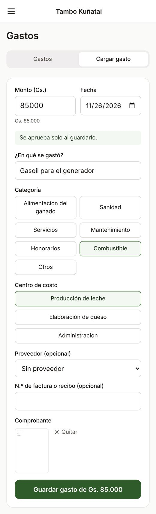 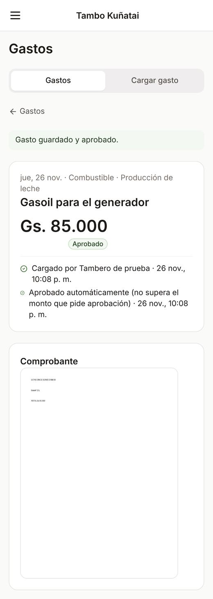

En **Gastos** ves solo los tuyos y en qué estado están. Si el dueño **rechaza** uno, aparece su comentario:
tocá **Corregir este gasto**, arreglalo y se vuelve a enviar.

**Compras de insumos** (cuajo, sal, bolsas…): se cargan en **Compras → Registrar compra**, con el
proveedor, cada insumo con su cantidad y precio, y la foto de la factura. Al guardar, el stock sube solo.

---

## 4. Vender y cobrar (rol Ventas)

### Registrar una venta

1. Menú → **Ventas y cobros** → **Registrar venta**.
2. **1. Cliente**: escribí parte del nombre y tocá el cliente. Si es nuevo, tocá **Cliente nuevo**.
   Debajo del nombre ves si el cliente ya debe algo.
3. **2. Producto y cantidad**: tocá **Queso Paraguay** o **Leche cruda** y escribí la cantidad.
   El sistema muestra cuánto hay **disponible para vender** y de qué lote sale (primero el más viejo).
   No deja vender más de lo que hay.
4. **3. Precio y cobro**: el precio sale de la tabla de precios según el tipo de cliente y la cantidad.
   - **Ya se entregó**: dejalo marcado si la mercadería se entregó en el momento.
   - **Se cobró todo ahora**: marcalo si pagó todo; si queda debiendo, desmarcalo.
5. Tocá **Registrar venta por Gs. …**.

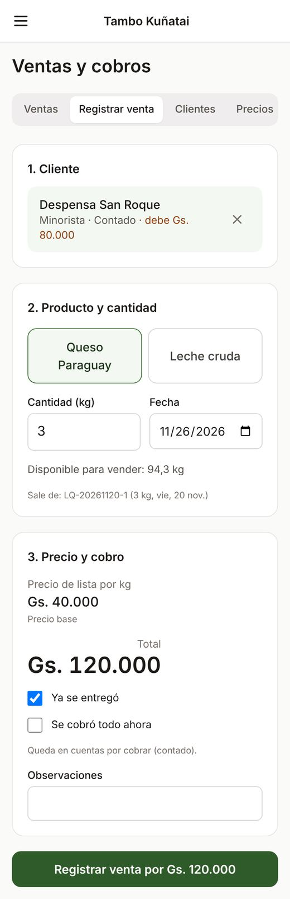 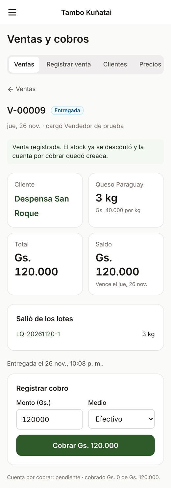

El stock se descuenta solo y, si no se cobró todo, queda la cuenta por cobrar.

### Registrar un cobro

1. Abrí la venta (Ventas y cobros → **Ventas** → tocá la venta).
2. En **Registrar cobro**, escribí el **Monto**, elegí el **Medio** (efectivo, transferencia…) y, si es
   transferencia, la referencia.
3. Tocá **Cobrar Gs. …**. Si es un pago parcial, el botón dice cuánto queda.

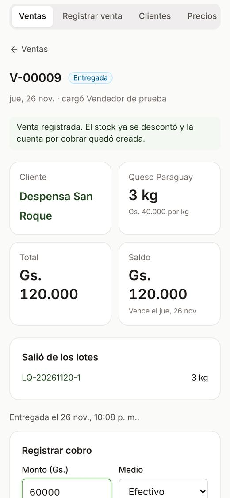 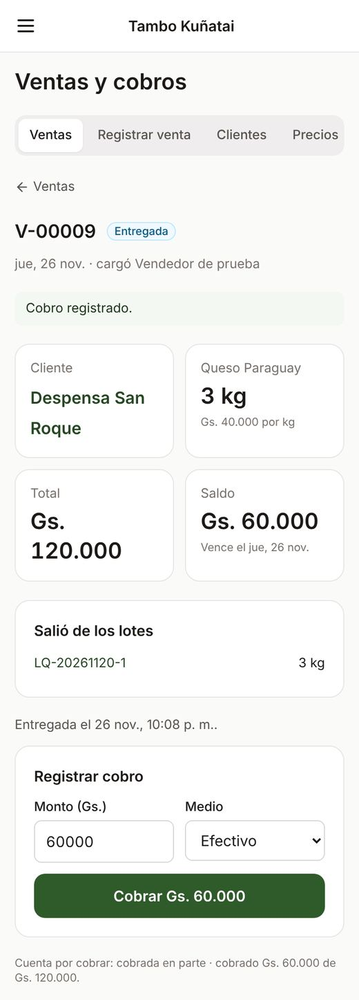

### Mis ventas

En **Reportes → Mis ventas** ves cuánto vendiste y cobraste en el período (por defecto, el mes) y **cuánto
te falta cobrar** de tus ventas, con lo vencido en rojo.

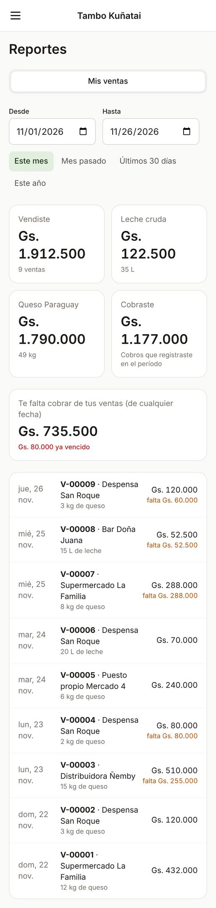

---

## Problemas comunes

| Lo que aparece | Qué hacer |
| -------------- | --------- |
| *No hay conexión con el sistema. Revisá la señal…* | Buscá señal o wifi y tocá de nuevo el botón. La leche se guarda igual en el teléfono. |
| *Usuario o clave incorrectos.* | Revisá mayúsculas y que el usuario esté bien escrito. |
| *Demasiados intentos fallidos con este usuario…* | Esperá 15 minutos o pedile al dueño que te restablezca la clave. |
| *Tu rol no tiene permiso para hacer esto.* | Esa tarea la hace el Administrador. Avisale. |
| *Revisá los datos. Litros: …* | Hay un dato mal escrito; el mensaje dice cuál. |
| *Esta sesión ya tiene el lote …* | Ese ordeñe ya está cargado. Para cambiarlo, entrá al lote y usá **Corregir datos del lote**. |
| *El lote … tiene … disponibles.* | Querés vender más de lo que hay en ese lote. Bajá la cantidad. |
| *No hay precio cargado para …* | Falta el precio en la tabla. Pedile al dueño que lo cargue. |
| *El sistema tuvo un problema…* | Probá de nuevo en un rato. Si sigue, avisale al dueño con la hora en que pasó. |
| Aviso rojo: *el sistema no aceptó un lote guardado en el teléfono* | Ese ordeñe ya lo había cargado otra persona. Revisá con el dueño y tocá **Entendido**. |
